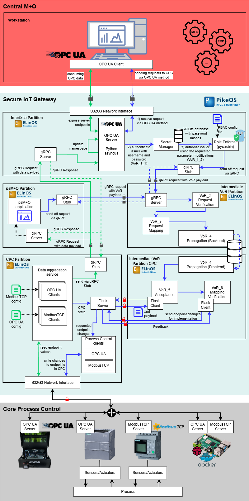
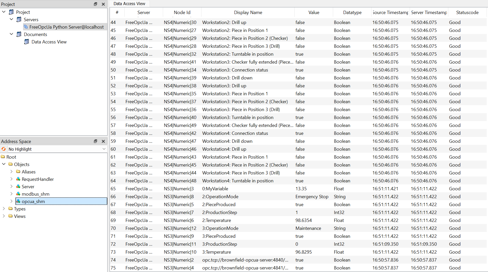
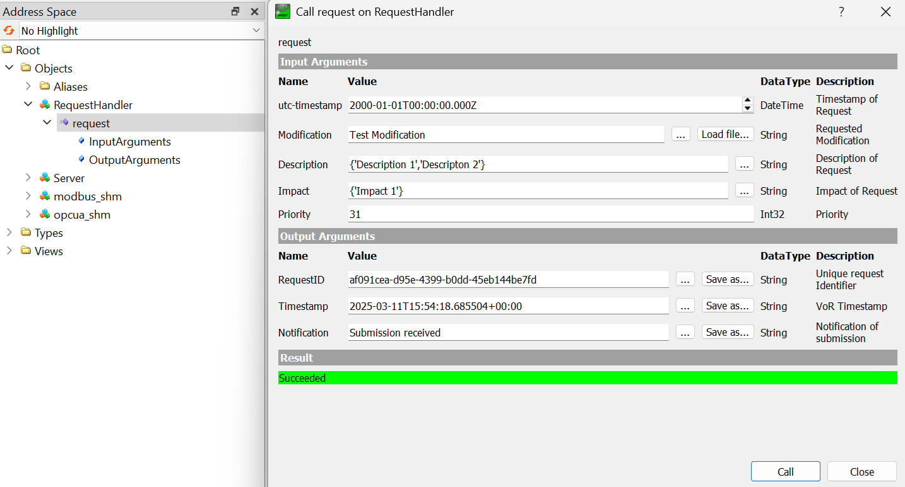

**Implementation of the Secure IoT Gateway**
=======================

_________

<br>
A guide for developers is available in [DEV.md](./DEV.md), with setup steps and configuration advice for different labs and equipment. Please refer to it for integration and development instructions.
_________
A Docker-based IoT gateway setup for OPC UA and ModbusTCP communication.

_________
<div style="background-color: #CCCCCC; color: black; padding: 10px; border-radius: 8px; font-size: 1.5em;">
  Brownfield services
</div>

-  **brownfield-server**: A simple OPC UA server container. Used for emulating a brownfield environment. This example is based on the example server-with-encryption.py provided by the FreeOpcUa Python library [(Link)](https://github.com/FreeOpcUa/opcua-asyncio/blob/master/examples/server-with-encryption.py).
- **modbus-server**: A Modbus TCP Server written in Python used for testing the collection from different registers. It is based on the Docker image [oitc/modbus-server](https://github.com/cybcon/modbus-server).
_________

<div style="background-color: #E0F2F1; color: black; padding: 10px; border-radius: 8px; font-size: 1.5em;">
  Secure IoT Gateway services
</div>

- **cpc-partition**: A container implementing clients for the communication protocols Modbus/TCP and OPC UA. The configuration via XML-files allows for flexible scaling and endpoint definition. The aggregated data from the Brownfield components is distributed via Shared Memory to the Interface and psM+O partitions. *Maintainer: Heiko Schoon (HS Emden/Leer)*
- **psmo-partition**: Contains a Python script for reading the shared memory of the cpc-partition and consuming the machine data stored inside. *Maintainer: Heiko Schoon (HS Emden/Leer)*
- **interface-partition**: OPC UA Server accessible from IT-side. Updates variables in namespace using the xml-file stored in shared memory from the cpc-partition container. Implements OPC UA methods for sending Requests to the Brownfield and to interact with the User-Management services (User database for authentication with username/password and authorization via PyCasbin [(Link)](https://github.com/casbin/pycasbin)). *Maintainer: Heiko Schoon (HS Emden/Leer)*
- **intermediate-vor-partition**: Implements the VoR steps (2, Request Verification), (3, Request Mapping) and (4, Propagation Backend). *Maintainer: Yuanchen Zhao (RWTH Aachen)*
- **intermediate-vor-partition-cpc**: Implements the VoR steps (4, Propagation Frontend), (5, Acceptance) and (6, Mapping Verification). *Maintainer: Yuanchen Zhao (RWTH Aachen)*
_________

<div style="background-color: #FF6665; color: black; padding: 10px; border-radius: 8px; font-size: 1.5em;">
  Central M+O services
</div>

- **central-mo-client**: OPC UA Client and business function. Uses the data exposed by the OPC UA Server for a currently undefined business function, e.g. visualization via node-red.
Also implements the fuzzing services for testing the different steps of the Verification-of-Request steps. *Maintainer: Heiko Schoon (HS Emden/Leer)*

______________________

# Modification Guide

This section provides steps and recommendations for developers working with the Secure IoT Gateway, tailored for different lab setups and industrial demonstrators. Follow the instructions for your environment to ensure correct integration and configuration.

---

## Setup

1. **Update Endpoints in XML Configuration**
   - Edit the XML files for OPC UA and MODBUS/TCP servers in:
     - `secure-iot-gateway/cpc-partition/config/`
   - Ensure endpoints match the network and equipment in your environment.

2. **Update RBAC Configuration**
   - Modify the roles and actions in:
     - `secure-iot-gateway/interface-partition/authorization_handler/rbac_test_with_impacts.csv`
   - Actions should correspond to VoR-impacts relevant to your use case.

3. **Update configs for the VoR Functionalities**
   - Edit the XML files in:
     - `secure-iot-gateway/intermediate-vor-partition/config/`
     - `secure-iot-gateway/intermediate-vor-partition-cpc/config/`

4. **Update OPC UA Certificates**
   - Add trusted client certificates (`.der` format) to:
     - `secure-iot-gateway/interface-partition/certificates/trusted/certs/`
   - Register new clients in the OPC UA server setup:
     - Edit `secure-iot-gateway/interface-partition/interface_setup/interface_setup.py` (see line 140+)
     - Use the `add_user` method to add new client certificates.

5. **Central M+O Services Development**
   - Program your own Central M+O services as needed.
   - The OPC UA server certificate for client authentication is located at:
     - `secure-iot-gateway/interface-partition/certificates/python-server/server_cert.der`

## General Recommendations
- **Configuration Management**: Always document changes to configuration files and certificates.
- **Testing**: After updates, test connectivity and authorization flows using UAExpert or your preferred OPC UA client.


**Usage in docker**
---------
Clone the repository using Git:
```bash
git clone https://github.com/hschoon-dev/secure-iot-gateway.git
```

Navigate to the repository directory
```bash
cd secure-iot-gateway
```
Building, (re)creating, starting:
```bash
docker-compose -f docker-compose.yaml up --build
```

### UAExpert view of the aggregated endpoints from CPC


### UAExpert VoR method call


### Docker Terminal


```bash
Attaching to brownfield-opcua-server, central-mo-client, interface-partition, intermediate-vor-partition
brownfield-opcua-server     | Brownfield OPC UA Servers started successfully.
interface-partition         | OPC UA Server of the interface partition is running.
central-mo-client           | Central M+O Application started.

# Submit Requests with running interface-partition, but offline intermediate-vor-partition: => requests will be stored in POSIX queue
central-mo-client           | Submit request with priority 9 at 2025-03-11 15:43:09.646760+00:00
interface-partition         | Request with priority 9 at 2025-03-11T15:43:09.651060+00:00 received and forwared.
central-mo-client           | Request ID:       cada693b-8e9a-4a77-8f96-21fbb38f91a6                                                                                  
central-mo-client           | Server Timestamp: 2025-03-11T15:43:09.651060+00:00                                                                                      
central-mo-client           | Notification:     Submission received
central-mo-client           | Submit request with priority 24 at 2025-03-11 15:43:11.655272+00:00                                                                     
interface-partition         | Request with priority 24 at 2025-03-11T15:43:11.657791+00:00 received and forwared.
central-mo-client           | Request ID:       32a0938f-f626-4873-b959-df3137f21517                                                                                  
central-mo-client           | Server Timestamp: 2025-03-11T15:43:11.657791+00:00
central-mo-client           | Notification:     Submission received                                                                                                   
central-mo-client           | Submit request with priority 5 at 2025-03-11 15:43:13.661215+00:00
interface-partition         | Request with priority 5 at 2025-03-11T15:43:13.662997+00:00 received and forwared.
central-mo-client           | Request ID:       a5592e3d-2448-43b0-afb1-133ac1b74a5c                                                                                  
central-mo-client           | Server Timestamp: 2025-03-11T15:43:13.662997+00:00
central-mo-client           | Notification:     Submission received                                                               

# intermediate-vor-partition started and begins processing message queue content with respect to the priority of the request.
intermediate-vor-partition  | Intermediate VoR Partition started!
intermediate-vor-partition  | Message Queue /interface_partition_mq attached!
intermediate-vor-partition  | Request with priority 24 and payload b"{'request_id': '32a0938f-f626-4873-b959-df3137f21517', 'timestamp': datetime.datetime(2025, 3, 11, 15, 43, 11, 655272, tzinfo=datetime.timezone.utc), 'modification': 'Enhance automated assembly line', 'description': {'description_0': 'Refactor sensor data integration', 'description_1': 'Install new automation features', 'description_2': 'Enable production line optimization'}, 'impact': {'impact_0': 'Lower operational costs', 'impact_1': 'Higher yield rates'}, 'prio': 24}" received.
intermediate-vor-partition  | Request with priority 9 and payload b"{'request_id': 'cada693b-8e9a-4a77-8f96-21fbb38f91a6', 'timestamp': datetime.datetime(2025, 3, 11, 15, 43, 9, 646760, tzinfo=datetime.timezone.utc), 'modification': 'Improve sensor calibration process', 'description': {'description_0': 'Enhance production scheduling'}, 'impact': {'impact_0': 'Increased throughput', 'impact_1': 'Faster production cycles', 'impact_2': 'Improved resource utilization'}, 'prio': 9}" received.
intermediate-vor-partition  | Request with priority 5 and payload b"{'request_id': 'a5592e3d-2448-43b0-afb1-133ac1b74a5c', 'timestamp': datetime.datetime(2025, 3, 11, 15, 43, 13, 661215, tzinfo=datetime.timezone.utc), 'modification': 'Update production software', 'description': {'description_0': 'Update system diagnostics'}, 'impact': {'impact_0': 'Higher yield rates'}, 'prio': 5}" received.

# Now the request come in and all partitions that are associated with their processing are running.
central-mo-client           | Submit request with priority 14 at 2025-03-11 15:43:15.665898+00:00
interface-partition         | Request with priority 14 at 2025-03-11T15:43:15.667656+00:00 received and forwared.
intermediate-vor-partition  | Request with priority 14 and payload b"{'request_id': '69460836-f61e-448d-8f7a-c8edf25135d6', 'timestamp': datetime.datetime(2025, 3, 11, 15, 43, 15, 665898, tzinfo=datetime.timezone.utc), 'modification': 'Install new production machinery', 'description': {'description_0': 'Enhance production scheduling'}, 'impact': {'impact_0': 'Enhanced system reliability', 'impact_1': 'Faster production cycles'}, 'prio': 14}" received.
central-mo-client           | Request ID:       69460836-f61e-448d-8f7a-c8edf25135d6
central-mo-client           | Server Timestamp: 2025-03-11T15:43:15.667656+00:00
central-mo-client           | Notification:     Submission received                                                                 

central-mo-client           | Submit request with priority 28 at 2025-03-11 15:43:17.670960+00:00                                                                 
interface-partition         | Request with priority 28 at 2025-03-11T15:43:17.673943+00:00 received and forwared.
intermediate-vor-partition  | Request with priority 28 and payload b"{'request_id': '650b6353-0706-4513-ba86-2e3dafcf86e0', 'timestamp': datetime.datetime(2025, 3, 11, 15, 43, 17, 670960, tzinfo=datetime.timezone.utc), 'modification': 'Implement new machine learning model', 'description': {'description_0': 'Enable production line optimization', 'description_1': 'Install new automation features'}, 'impact': {'impact_0': 'Reduced downtime'}, 'prio': 28}" received.
central-mo-client           | Request ID:       650b6353-0706-4513-ba86-2e3dafcf86e0
central-mo-client           | Server Timestamp: 2025-03-11T15:43:17.673943+00:00                                                                                      
central-mo-client           | Notification:     Submission received

central-mo-client           | Submit request with priority 2 at 2025-03-11 15:43:19.677723+00:00
intermediate-vor-partition  | Request with priority 2 and payload b"{'request_id': '14ec21c6-00d8-4dcc-9a97-8674ca8caf4d', 'timestamp': datetime.datetime(2025, 3, 11, 15, 43, 19, 677723, tzinfo=datetime.timezone.utc), 'modification': 'Upgrade system monitoring tools', 'description': {'description_0': 'Update system diagnostics', 'description_1': 'Update inventory tracking system', 'description_2': 'Install new automation features'}, 'impact': {'impact_0': 'Reduced downtime'}, 'prio': 2}" received.
interface-partition         | Request with priority 2 at 2025-03-11T15:43:19.680922+00:00 received and forwared.
central-mo-client           | Request ID:       14ec21c6-00d8-4dcc-9a97-8674ca8caf4d
central-mo-client           | Server Timestamp: 2025-03-11T15:43:19.680922+00:00                                                                                      
central-mo-client           | Notification:     Submission received
```

## Setup of the MariaDB database
The database is used for the Request-Transport from the VoR-1-partition to the VoR-2-partition. It is currently hosted on a RPi 4B (siot@192.168.178.117).
The setup script for the database can be found [here](./maria-db/01_init.sh).

### Configuration
```terminal
 > SHOW DATABASES;
+--------------------+
| Database           |
+--------------------+
| information_schema |
| mysql              |
| performance_schema |
| secure_iot_gateway |
+--------------------+
```

```terminal
 > SELECT user, host FROM mysql.user;
+------------------+-----------+
| user             | host      |
+------------------+-----------+
| root             | localhost |
| vor-1            | %         |
| vor-2            | %         |
+------------------+-----------+
```
Default passwords for the users are: VoR-X-Password with 'X' as the partition number.

### User-Management
```terminal
-- Remove old user
DROP USER 'vor-X'@'%';

-- Create new users with remote access
CREATE USER 'vor-X'@'%' IDENTIFIED BY 'NewPassword';

-- Grant privileges to the database
GRANT ALL PRIVILEGES ON secure_iot_gateway.* TO 'vor-X'@'%';

FLUSH PRIVILEGES;
```
_________
**Dependencies**
--------------

* Python 3.x libraries:
	+ `asyncua` — OPC UA communication
	+ `pyModbusTCP` — ModbusTCP communication
	+ `xmlschema` — XML Schema validation and parsing
	+ `posix-ipc` — POSIX-based inter-process communication
	+ `casbin` — Authorization/Access control
	+ `bcrypt` — Password hashing and security
	+ `requests` — HTTP requests
	+ `flask` — Web application framework
	+ tbc
* Docker Engine
_________
**Partners**
------------------

_________

**Contact**
------------------
**Heiko Schoon** 
University of Applied Sciences Emden/Leer
[heiko.schoon@hs-emden-leer.de](mailto:heiko.schoon@hs-emden-leer.de)

_________


**Licensing**
------------------
Gratis or libre? … No, gratis and libre:
This is free software (free as in speech and free as in beer) released under the Apache License 2.0. It includes components licensed under MIT; their notices are included. See [LICENSE](./LICENSE) and [LICENSES](./LICENSES/MIT-License-yuanchen-zhao.txt) for full details.